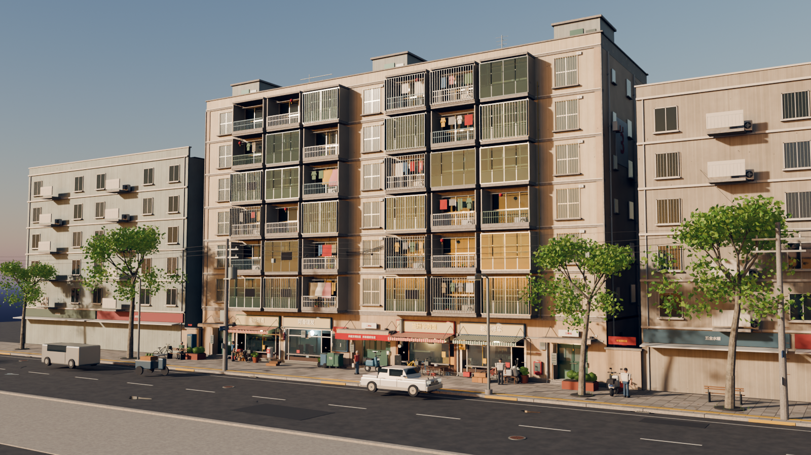

# Xingfuli No. 3 — A Chinese Residential Neighborhood

[简体中文](README.md) | **English**

**Created with DeepSeek V4.1 Flash 1017.**

[Live preview](https://kang340.github.io/xingfuli-residential/) · [GitHub](https://github.com/kang340/xingfuli-residential) · [MIT License](LICENSE)

A procedural Blender scene of an everyday Chinese neighborhood: six residential floors above small shops, three stairwell entrances, enclosed and open balconies, rooftop solar water heaters, and a street with trees, vehicles, neighbors, and a cat. Geometry and materials are generated in Python without external models or image textures.



## Online preview

The website supports Chinese / English switching, five camera views, a full-size image viewer, and a download of the original Blender scene. It displays rendered images; open the downloaded `.blend` file in Blender to explore the actual 3D geometry.

## Open the scene

Open `中国居民楼_幸福里.blend` in **Blender 5.2 LTS**. The scene is approximately 4.6 MB, with around 5,900 objects. Press `F12` to render the active camera.

| Saved camera | View |
| --- | --- |
| `相机_主视角` | Building and street overview |
| `相机_立面细节` | Balconies and storefronts |
| `相机_单元入口` | Entrance, mailboxes, and community banner |
| `相机_街景` | Trees, cars, and street life |
| `相机_屋顶` | Solar water heaters, tanks, and antennas |

## Generate and render

Run from the repository root, with the Blender executable on your PATH:

```sh
blender -b --factory-startup --python scripts/build_scene.py
blender -b --factory-startup --python scripts/build_scene.py -- --preview
blender -b --factory-startup --python scripts/render_final.py
```

Alternatively, replace `blender` with the full path to your Blender executable. Scripts resolve the project directory automatically. Rebuilding overwrites the scene file; rendering writes images to `renders/`. Back up manual edits before regenerating.

The supplied scripts are configured for Cycles with OptiX GPU rendering. Adjust device settings for your hardware. Signage uses local Chinese fonts; update `load_fonts()` in `scripts/scene_lib.py` when the Windows font paths are unavailable. No font files are distributed.

## Scene details

- Building: 36 m wide, 12 m deep, with three entrances, six residential stories, and ground-floor retail.
- Facade: tiled walls, grilles, AC units and piping, laundry racks, flowerpots, mailboxes, and small household details.
- Shops: a corner shop, barber, Lanzhou beef noodle house, and bicycle repair shop.
- Roof: solar water heaters, tanks, antennas, satellite dishes, laundry lines, and utility structures.
- Street: pavement, cars, bikes, plane trees, overhead wires, pedestrians, and a cat.
- Lighting: low evening sunlight, cool sky fill, and warm shop interiors.

This is an artistic interpretation of a familiar neighborhood, rather than a measured reconstruction of a real building. Small props and interiors are simplified.

## Repository structure

```text
中国居民楼_幸福里.blend  Original scene
scripts/               Python geometry, materials, assembly, and rendering
renders/               Original render images
assets/                Compressed WebP images used by the website
index.html             Preview website
styles.css             Responsive layout
app.js                 Language switching and image gallery
.github/workflows/     GitHub Pages deployment
```

## Local website preview

The website has no build dependencies. Serve the repository with Python:

```sh
python -m http.server 8000
```

Open `http://localhost:8000`. To test the model download locally, create a `downloads/` directory and copy the `.blend` file there as `xingfuli.blend`. GitHub Actions creates this download automatically for the published site.

## License and credits

Code, scene files, and rendered images are released under the [MIT License](LICENSE). Preserve the copyright and license notice when redistributing.

Model creation: **DeepSeek V4.1 Flash 1017**. Tools: **Blender / Cycles**. The bilingual preview website and publishing setup were added for this release.
